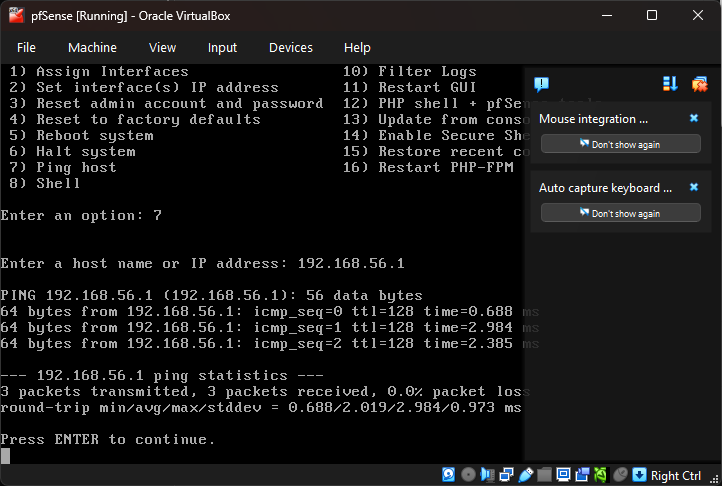
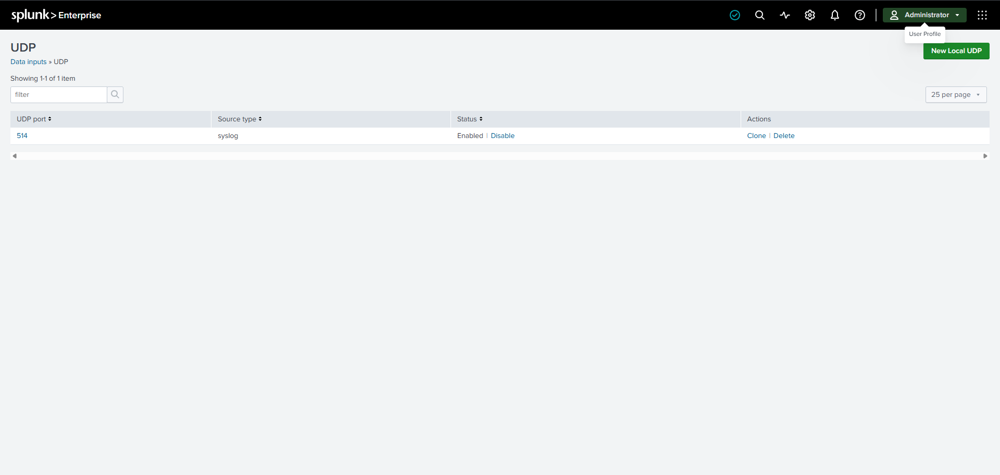
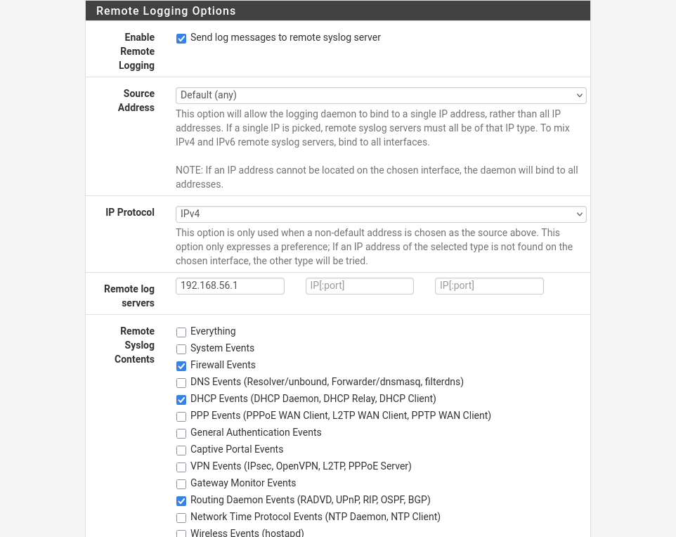
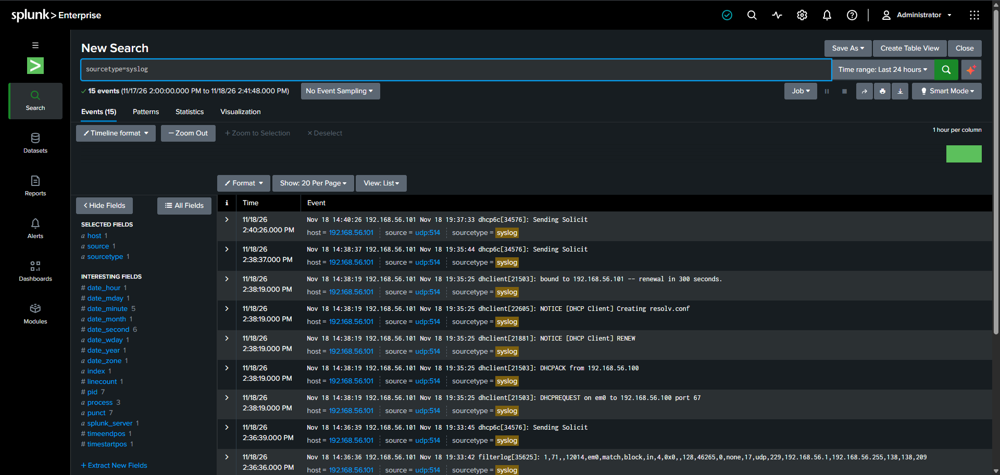

# Lab 01: Splunk Enterprise SIEM & pfSense Firewall Log Ingestion

## Objective
Deploy a working SIEM pipeline by bridging a virtualized **pfSense CE** firewall to a **Splunk Enterprise (v10.6.1.1)** instance, ingesting live firewall (`filterlog`), DHCP, and routing logs over **UDP port 514**, and filtering blocked traffic using Splunk Processing Language (SPL).

---

## Lab Architecture
* **Firewall VM:** pfSense CE on Oracle VirtualBox (`192.168.56.101`)
* **SIEM Server:** Splunk Enterprise v10.6.1.1 running natively on Windows Host (`192.168.56.1`)
* **Network Bridge:** VirtualBox Host-Only Adapter (`192.168.56.0/24`)
* **Log Protocol:** Remote Syslog over `UDP 514` (`sourcetype=syslog`)

---

## Implementation & Verification

### 1. Network Connectivity Verification
Configured a VirtualBox Host-Only interface to connect pfSense directly to the Windows host and verified Layer 3 reachability from the pfSense console (`0.0% packet loss`).



### 2. Splunk UDP 514 Listener & Windows Firewall Rule
Created a local UDP input on port `514` (`sourcetype=syslog`) in Splunk Enterprise and added an inbound Windows Firewall rule via PowerShell to permit syslog traffic:

```powershell
New-NetFirewallRule -DisplayName "Splunk Syslog UDP 514" -Direction Inbound -Protocol UDP -LocalPort 514 -Action Allow
```



### 3. pfSense Remote Syslog Forwarding
Enabled Remote Logging under **Status > System Logs > Settings**, targeting `192.168.56.1` for Firewall, DHCP, and Routing events.



### 4. Live Log Ingestion & SPL Filtering
Confirmed real-time ingestion in Splunk **Search & Reporting**, capturing `dhclient` renewals and live `filterlog` block events (`match,block,in`) on interface `em0`.

```spl
# Filter for pfSense firewall events only
sourcetype=syslog process=filterlog

# Isolate blocked inbound/outbound traffic
sourcetype=syslog process=filterlog "block"
```



---

## Troubleshooting & Lessons Learned
* **Resource & OS Bottleneck Diagnosis:** Initial deployment inside a Kali Linux VM hit repeated `splunkweb` startup hangs on port `8000` (`127.0.0.1:8065` connection refused). Using `free -h`, `ss -tulpn`, and `splunkd.log`, I identified a 2 GB RAM allocation causing heavy swap thrashing alongside rolling-release compatibility issues with Splunk's Python 3.13 appserver.
* **Architectural Pivot:** Upgraded VM resources, tested containerized deployment via Docker (resolving NTP clock skew that triggered Docker Hub token expirations), and ultimately deployed Splunk natively on the Windows host bridged over a VirtualBox Host-Only subnet (`192.168.56.0/24`) for zero virtualization overhead and instant search performance.
* **Timezone Alignment:** Observed UTC timestamps in raw pfSense syslog payloads versus local EST indexing in Splunk, highlighting the importance of NTP and timezone standardization across SIEM log sources.
