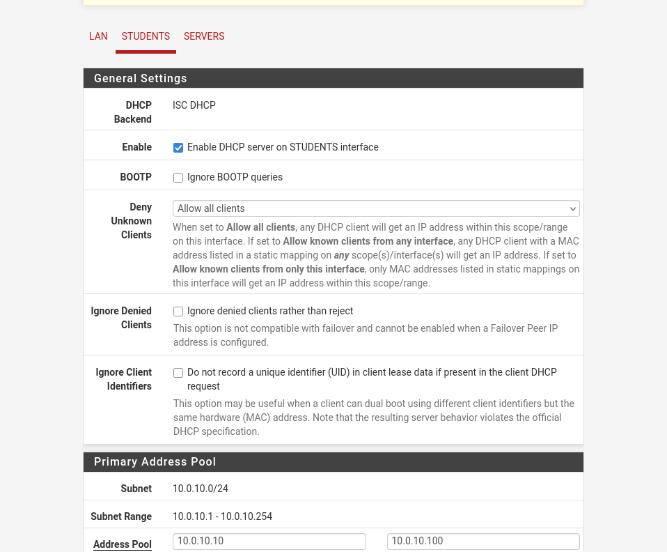
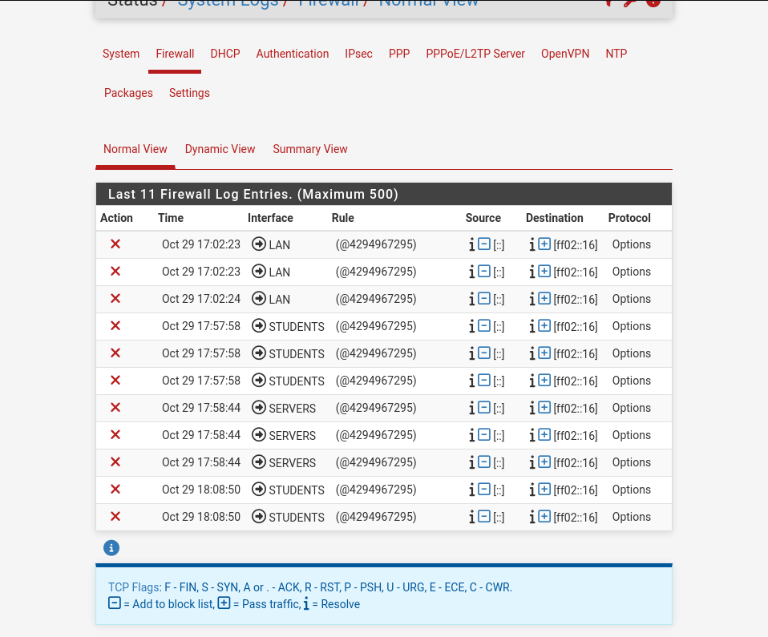

# Lab 02: pfSense CE Firewall & VLAN Segmentation

## Objective
Deploy a virtualized **pfSense CE** firewall and router in **Oracle VirtualBox** to segment internal network traffic using VLANs (**LAN-Net** and **Students VLAN**), enforcing least-privilege firewall rules and verifying inter-VLAN isolation.

---

## Lab Architecture
* **Hypervisor:** Oracle VirtualBox (Multi-VM Internal & NAT Networking)
* **Firewall / Router:** pfSense CE (WAN, LAN-Net, and Students VLAN interfaces)
* **Segmented Subnets:** Separate broadcast domains for `LAN-Net` (administrative/trusted) and `Students VLAN` (restricted user segment)
* **Security Controls:** Stateful packet filtering, interface-level firewall rules, and inter-VLAN block policies

---

## Implementation & Verification

### 1. Interface & VLAN Configuration
Assigned WAN and LAN interfaces in pfSense CE and created the tagged **Students VLAN** interface alongside **LAN-Net**, configuring dedicated static IP gateways and DHCP scopes for each segment.

### 2. DHCP & Subnet Allocation
Enabled DHCP services on both **LAN-Net** and **Students VLAN** so client VMs automatically receive segment-specific IP addresses, subnet masks, and default gateways.

### 3. Firewall Rules & Traffic Filtering
Configured stateful firewall rules on the **Students VLAN** interface to permit necessary outbound internet/DNS access while explicitly blocking lateral movement to **LAN-Net** and restricting access to the pfSense Web GUI.

### 4. Segmentation & Isolation Verification
Validated policy enforcement from client VMs by testing internet reachability and confirming that cross-VLAN ICMP/management traffic from **Students VLAN** to **LAN-Net** is dropped by the firewall.

---

## Key Takeaways
* **Defense in Depth:** Segmenting untrusted or user-facing devices onto a dedicated VLAN limits the blast radius of compromised endpoints and prevents lateral movement toward administrative assets.
* **Rule Order Matters:** pfSense evaluates firewall rules top-down (first match wins), requiring explicit block rules against private internal subnets (`LAN-Net`) *above* general outbound allow rules.
* **Least-Privilege Management:** Restricting access to the firewall Web GUI from guest/student VLANs prevents unauthorized configuration tampering.
