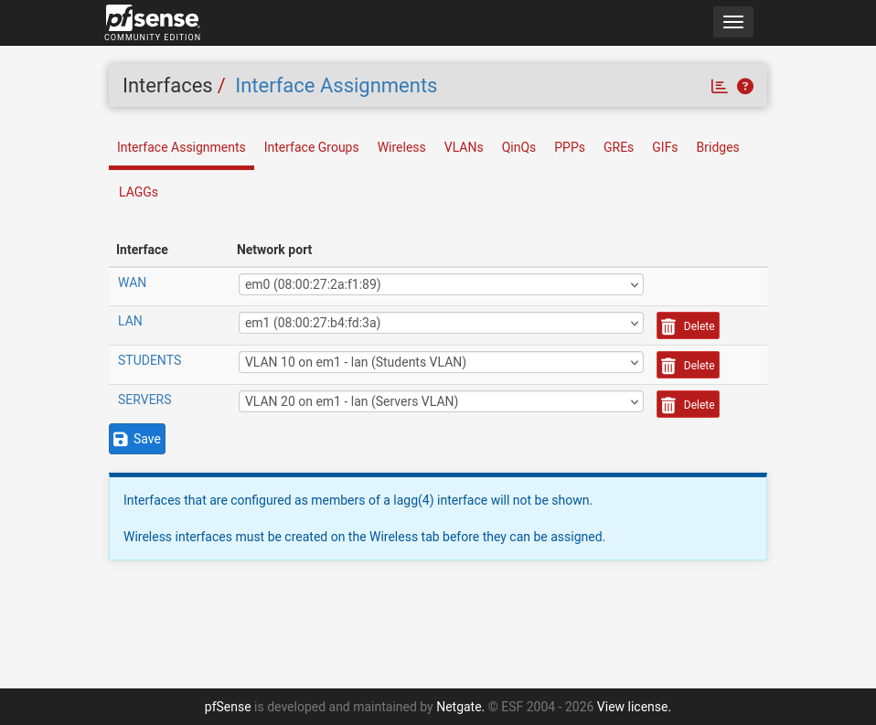
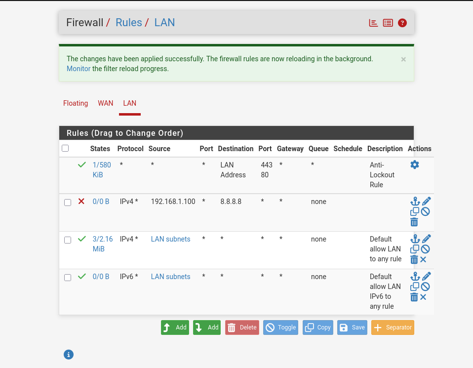

# Lab 02: pfSense CE Firewall & VLAN Segmentation

## Objective
Deploy a virtualized **pfSense CE** firewall and router in **Oracle VirtualBox** to segment internal network traffic across dedicated VLANs (**VLAN 10 — STUDENTS** and **VLAN 20 — SERVERS**), configure segment-specific DHCP scopes and NAT port forwarding, and enforce stateful firewall rules.

---

## Lab Architecture
* **Hypervisor:** Oracle VirtualBox (Multi-VM NAT & Internal Networking)
* **Firewall / Router:** pfSense CE (`WAN` on `em0`, `LAN` on `em1`)
* **Network Segments:**
  * **LAN (`em1`):** `192.168.1.0/24` (Administrative / Default LAN)
  * **STUDENTS (`VLAN 10` on `em1`):** `10.0.10.0/24` (DHCP Pool: `10.0.10.10 – 10.0.10.100`)
  * **SERVERS (`VLAN 20` on `em1`):** `10.0.20.0/24` (DHCP Pool: `10.0.20.10 – 10.0.20.100`)
* **Security Controls:** Stateful packet filtering, top-down LAN/VLAN firewall rules, Anti-Lockout management protection, and WAN-to-SERVERS NAT port forwarding (`WAN TCP 80` → `10.0.20.10:80`)

---

## Implementation & Verification

### 1. Interface & VLAN Assignments
Configured `WAN` (`em0`) and `LAN` (`em1`) in pfSense CE, then created and assigned tagged **VLAN 10 (`STUDENTS`)** and **VLAN 20 (`SERVERS`)** sub-interfaces on `em1` to isolate user endpoints from internal servers.

### 2. Per-VLAN DHCP & Subnet Allocation
Enabled ISC DHCP servers independently on **STUDENTS** (`10.0.10.0/24`, pool `10.0.10.10 – 10.0.10.100`) and **SERVERS** (`10.0.20.0/24`, pool `10.0.20.10 – 10.0.20.100`) so clients on each VLAN automatically receive isolated subnet addressing.

### 3. Stateful Firewall Rules & NAT Port Forwarding
Configured top-down firewall rules under **Firewall > Rules > LAN**—placing an explicit IPv4 block rule (`192.168.1.100` → `8.8.8.8`) above the default allow-any rule while preserving the Anti-Lockout rule on ports `80/443`. Also configured a simulated WAN HTTP NAT port forward (`TCP 80` → `10.0.20.10:80`) to the **SERVERS** VLAN.

### 4. Firewall Logging & Policy Verification
Verified active rule enforcement under **Status > System Logs > Firewall**, confirming pfSense logged and blocked unauthorized traffic across the **LAN**, **STUDENTS**, and **SERVERS** interfaces.

---

## Key Takeaways
* **Defense in Depth:** Separating user endpoints (`VLAN 10`) from internal servers (`VLAN 20`) limits lateral movement and contains the blast radius if a client host is compromised.
* **Top-Down Rule Evaluation:** pfSense processes firewall rules sequentially (first match wins), meaning specific block rules must always sit *above* broad allow rules.
* **Controlled Service Exposure:** Using NAT port forwarding exposes only a single required port (`TCP 80`) to a dedicated server IP (`10.0.20.10`) inside the `SERVERS` VLAN rather than exposing the entire internal network.
