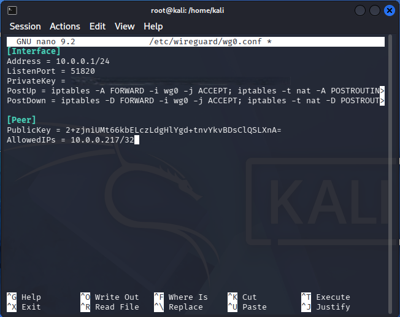
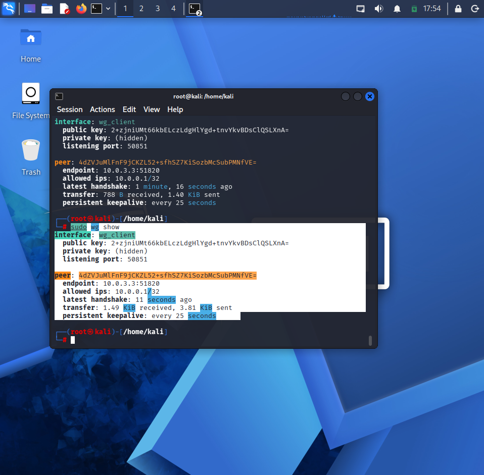
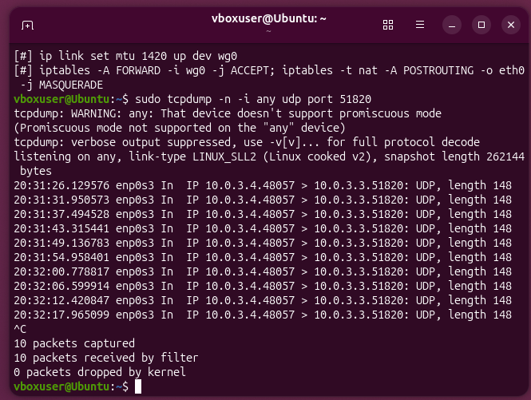
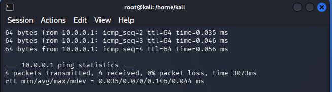

# Lab 03: WireGuard VPN Architecture & Packet-Level Traffic Analysis

## Objective
Architect and deploy an encrypted point-to-point **WireGuard VPN** tunnel between **Ubuntu Server** and **Kali Linux** over **UDP port 51820**, enforce strict cryptographic file permissions, and use `tcpdump` packet inspection to diagnose and resolve kernel routing, clock skew, and key-pair issues.

---

## Lab Architecture
* **Hypervisor:** Oracle VirtualBox (Multi-VM NAT Network)
* **VPN Server:** Ubuntu Server (`10.0.0.1/24` on `wg0`)
* **VPN Client:** Kali Linux (`10.0.0.217/32` on `wg0`)
* **Protocol & Port:** WireGuard over `UDP 51820` using Base64 asymmetric key pairs
* **Routing & Firewall:** `iptables` NAT masquerading, `ufw` host firewall rules, and `sysctl` IP forwarding / Reverse Path Filtering (`rp_filter`)

---

## Implementation & Verification

### 1. Asymmetric Key Generation & Hardened Configuration
Generated Base64 public/private key pairs on both hosts, configured `/etc/wireguard/wg0.conf` with `iptables` NAT masquerading rules, and enforced least-privilege security (`root:root` ownership and `chmod 600`) on all private keys and configuration files.

```bash
# Enforce strict permissions on WireGuard configurations
sudo chown -R root:root /etc/wireguard
sudo chmod 600 /etc/wireguard/wg0.conf
```



### 2. Tunnel Handshake & Status Verification
Brought up the `wg0` interfaces on Ubuntu Server and Kali Linux and confirmed an active cryptographic handshake, endpoint binding, and encrypted byte transfer using `sudo wg show`.

```bash
sudo wg-quick up wg0
sudo wg show
```



### 3. Packet-Level Inspection with `tcpdump`
Captured live traffic on UDP port `51820` via `tcpdump` to inspect **148-byte WireGuard handshake initiation payloads** and verify encrypted transport packets flowing between the Ubuntu and Kali VMs.

```bash
sudo tcpdump -i any udp port 51820 -vv
```



### 4. End-to-End Encrypted Connectivity Test
Verified bidirectional Layer 3 reachability across the encrypted tunnel by pinging the Ubuntu Server VPN gateway (`10.0.0.1`) from Kali Linux (`10.0.0.217`).



---

## Troubleshooting & Lessons Learned
* **Reverse Path Filtering (`rp_filter`):** Isolated silent packet drops caused by strict Linux kernel loopback routing (`sysctl` `rp_filter`), adjusting kernel parameters so asymmetric virtualized interfaces wouldn't discard valid VPN traffic.
* **UTC Clock Skew & Replay Protection:** Identified and resolved a system clock mismatch between VMs using NTP time synchronization—critical because WireGuard's TAI64N timestamp checks reject handshakes with out-of-sync clocks to prevent replay attacks.
* **Key-Pair & Firewall Isolation:** Used `tcpdump` to separate host firewall (`ufw`/`iptables`) blocks from mismatched Base64 public keys, confirming whether 148-byte initiation packets reached the peer before being silently dropped.
