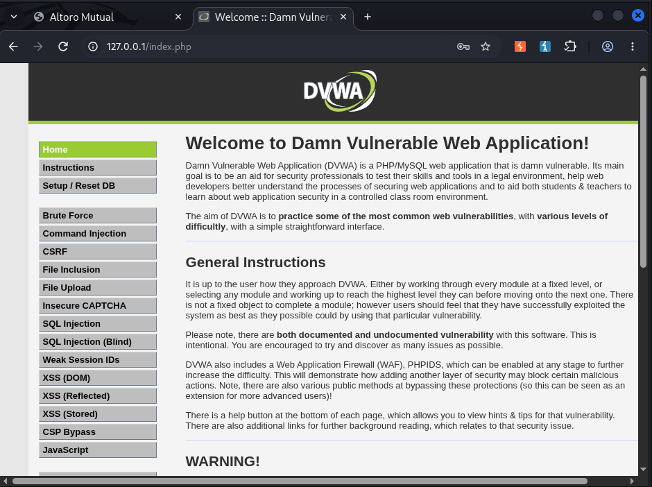
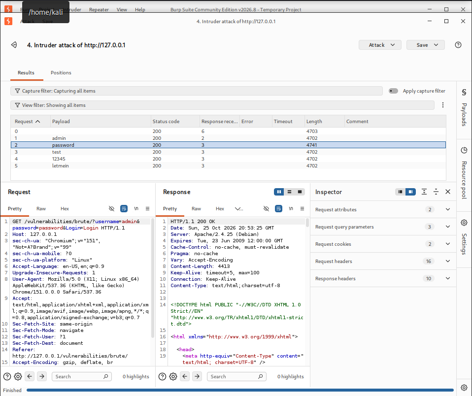
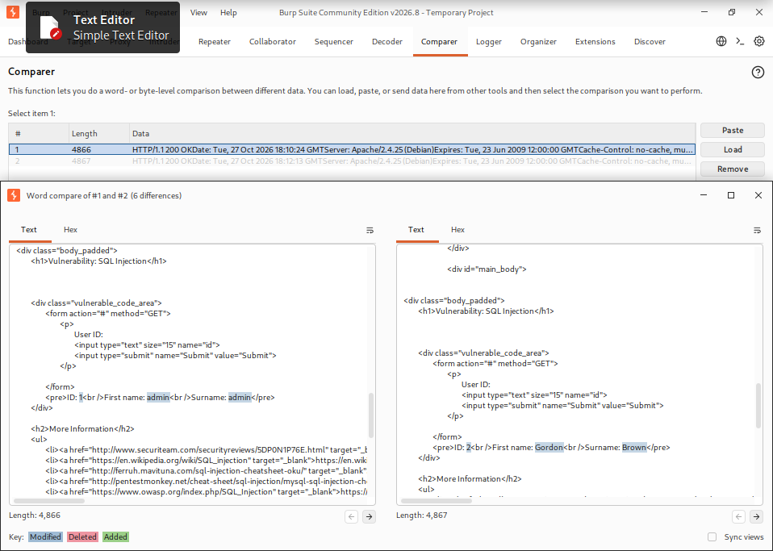
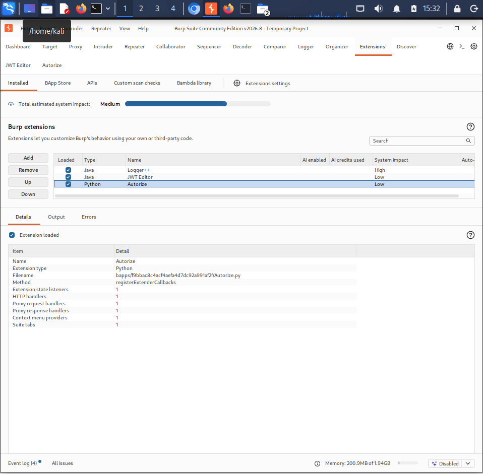

# Lab 04: Burp Suite Web Application Security Walkthrough (DVWA)

## Objective
Conduct a hands-on web application security assessment using **Burp Suite** against a containerized **Damn Vulnerable Web Application (DVWA)** instance on Kali Linux—demonstrating HTTP proxy interception, user enumeration, payload decoding/comparison, and BApp Store extensions (**JWT Editor** and **Logger++**) as part of a technical walkthrough presented to fellow **CyberTection** interns.

---

## Lab Architecture
* **Testing Host:** Kali Linux on Oracle VirtualBox
* **Target Application:** DVWA (`vulnerables/web-dvwa`) running in Docker
* **Interception Proxy:** Burp Suite (`127.0.0.1:8080`)
* **Core Modules Used:** Proxy, Repeater, Decoder, Comparer
* **BApp Store Extensions:** **JWT Editor** (JSON Web Token inspection/manipulation) and **Logger++** (granular HTTP traffic logging and filtering)

---

## Implementation & Verification

### 1. DVWA Deployment & Proxy Interception
Launched the local `vulnerables/web-dvwa` Docker container and configured browser traffic through Burp Suite Proxy (`127.0.0.1:8080`) to capture and inspect live HTTP requests and session cookies.

```bash
sudo docker run --rm -it -p 80:80 vulnerables/web-dvwa
```



### 2. Authentication Testing & User Enumeration
Analyzed DVWA login and authentication endpoints in Burp Suite to identify subtle differences in HTTP response codes, error messages, and response lengths that allow an attacker to enumerate valid user accounts.



### 3. Payload Analysis with Decoder & Comparer
Used Burp **Decoder** to transform encoded parameters and tokens (URL, Base64, HTML) and **Comparer** to diff HTTP responses word-by-word and byte-by-byte to isolate application behavior changes.



### 4. Extending Capabilities with BApp Store Extensions
Installed and demonstrated **JWT Editor** and **Logger++** from the BApp Store to inspect token structures and log/filter all outbound requests across Burp Suite tools in real time.



---

## Key Takeaways
* **Preventing User Enumeration:** Applications should return uniform authentication error messages and consistent response times/lengths regardless of whether a username exists.
* **Visibility Through Extensions:** Native Burp modules handle core interception, while **Logger++** and **JWT Editor** provide the logging depth and token-inspection controls needed for modern web and API assessments.
* **Peer Knowledge Sharing:** Presenting this workflow live to CyberTection internship peers reinforced how to translate raw HTTP findings into clear remediation steps.
